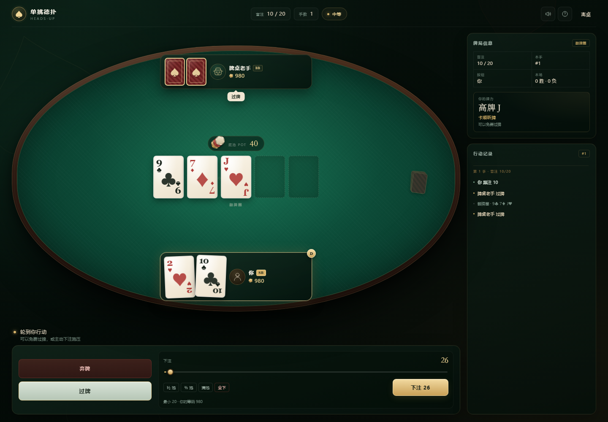

# 单挑德扑 · Heads-Up Hold'em

一款单机、离线的单挑无限注德州扑克。玩家对战一位 AI，可选简单 / 中等 / 困难三档难度，按标准单挑规则进行完整下注轮、全下、发牌与摊牌。



## 如何游玩

直接用 Edge / Chrome / Firefox 打开 `index.html` 即可，无需安装、无需联网、无需启动服务器。

```
texas-holdem/
├─ index.html          # 入口，双击打开
├─ css/style.css       # 牌桌与响应式界面
├─ js/poker.js         # 牌型评估、听牌、Chen 分数、蒙特卡洛胜率
├─ js/table.js         # 单挑下注规则、盲注、全下、底池结算
├─ js/ai.js            # 三档 AI 策略
├─ js/app.js           # 游戏流程、界面、动画与音效
└─ tests/              # 引擎、规则与浏览器端自动化测试
```

## 规则实现

- 52 张牌，每人 2 张底牌，5 张公共牌，取 7 张中最好的 5 张。
- 四个下注轮：翻牌前、翻牌、转牌、河牌。
- 单挑规则：按钮位兼小盲，翻牌前先行动、翻牌后最后行动；下一手按钮轮换。
- 行动：弃牌、过牌、跟注、下注/加注、全下。
- 最小加注遵循上一次加注增量；筹码不足时可全下，短全下不会重开行动。
- 未被跟注的下注自动退回；摊牌平局平分底池。
- 起始筹码 1,000，盲注 10/20，每 10 手上涨一档。
- 一方筹码归零，比赛结束。

## 三档 AI

| 难度 | 对手 | 特点 |
| --- | --- | --- |
| 简单 | 新手小柯 | 松而被动，跟注偏多，几乎不诈唬 |
| 中等 | 牌桌老手 | 计算底池赔率，按牌面调整，偶尔听牌半诈唬 |
| 困难 | 冷面算法 | 蒙特卡洛胜率、对手范围收紧、平衡诈唬，并会利用你的弃牌倾向 |

AI 只能看到自己的底牌与公共牌；玩家的底牌不会被读取。

## 操作

- 点击按钮行动；拖动滑杆或使用 `½ 池 / ⅔ 池 / 满池 / 全下` 快捷加注。
- 键盘：`F` 弃牌，`C` 过牌/跟注，`Esc` 关闭弹窗或收起结果。
- 右上角可开关声音、查看规则、离桌。
- 结果页可选择“下一手”或“查看牌桌”；比赛结束后可再来一局。

## 测试

```bash
node --test tests/core.test.js tests/rules.test.js
```

包含牌型与踢脚比较、A2345 轮子顺、听牌识别、胜率方向性、单挑行动顺序、大小盲选项、最小加注、短全下、未跟注退款、平分底池、筹码守恒与 AI 行动合法性等测试。

浏览器端测试脚本位于 `tests/`，通过 Chrome DevTools Protocol 驱动，覆盖真实按钮加注、完整摊牌流程、全下跑马、结果页、再来一局与离桌流程。运行这些脚本前需在 9223 端口启动带远程调试的 Edge/Chrome。
